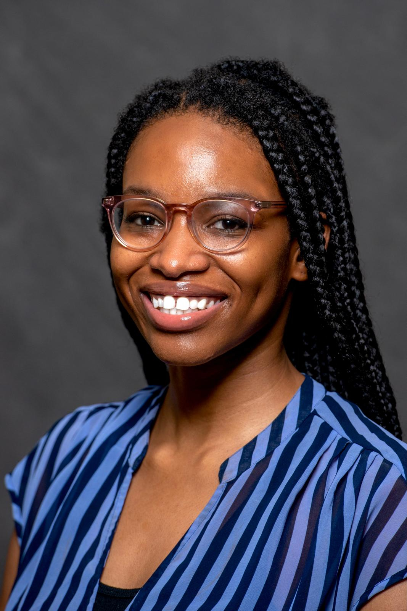

### Welcome

I'm a second-year MPH candidate in **Sociomedical Sciences** at the Columbia University Mailman School of Public Health, where I'm also completing a certificate in **Applied Biostatistics and Data Science**.

My research looks at how social determinants of health and area-level exposures shape clinical outcomes. Most of my current work is in the realm of breast cancer disparities and social epidemiology. I am passionate about studying the deeply interrelated social, structural, and biological drivers of cancer inequities.

### Explore this site

### Get in touch

The icons in the top right link to my email, GitHub, and LinkedIn.
